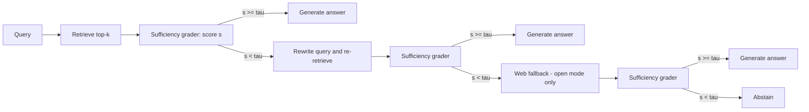

# Conformal Corrective RAG

**Risk-controlled routing between generate, rewrite, web fallback and abstain, evaluated under controlled retrieval noise.**

Mini Project | Prompt Engineering and Optimization for Generative AI (UE24AM343AB5) | B.Tech CSE (AI & ML), Semester 5

---

## Overview

Retrieval-Augmented Generation (RAG) grounds an LLM in external documents, but it silently assumes the retrieved context is good. When retrieval fails, the model still produces a fluent, confident, wrong answer.

Corrective RAG (CRAG, Yan et al., 2024) improves on this by grading the retrieved documents and routing to query rewriting or web search when they look poor. However, CRAG has three weaknesses:

1. Its relevance thresholds are **hand-set and uncalibrated**.
2. It **never abstains**: if the fallback is also poor, it still answers.
3. It offers **no guarantee** on how often its answers are wrong.

This project extends CRAG with:

| Contribution | Description |
|---|---|
| **Calibrated routing** | The decision threshold is chosen on a held-out set using Learn-then-Test style fixed-sequence binomial tests, so that the error rate of answered queries is bounded by a user-chosen `alpha` with probability at least `1 - delta`. |
| **Abstain as a route** | A fourth action, "I don't know", is taken when no stage produces sufficient evidence. |
| **Noise stress benchmark** | A noise injector corrupts retrieval in four controlled ways (irrelevant, missing, partial, outdated) so each route and grader can be measured as retrieval quality degrades. |

## How it works



- A prompted LLM grader returns a **sufficiency score** in [0, 1] for the evidence at each stage.
- The system answers at the **first stage** whose score reaches the threshold `tau`; otherwise it abstains.
- `tau` is **calibrated**, not guessed: candidate thresholds are tested from most to least conservative with an exact binomial test of `H0: risk(tau) > alpha`, stopping at the first failure. If no threshold can be certified with the available calibration data, the rule is "always abstain".
- **Closed-domain mode** disables the web stage to reflect data-governance limits; **open mode** enables it.

### Methods compared

| Method | Description |
|---|---|
| `standard_rag` | Retrieve and generate. Always answers. |
| `crag` | CRAG baseline: per-chunk grading with hand-set thresholds (0.7 / 0.3), rewrite and web fallback. Never abstains. |
| `sufficiency_abstain(0.5)` | Abstain if the first-stage score is below a fixed 0.5. No repair route. |
| `conformal_direct` | Calibrated abstention on the first stage only (ablation: no repair routes). |
| `naive_threshold_full` | Full router with the lowest threshold whose *empirical* risk is at most alpha. No guarantee (contrast for RQ1). |
| `conformal_full` | **Proposed.** Full router with a calibrated threshold. |
| `conformal_full_recal` | Same, but recalibrated under each noise condition (enabled with `--recal`). |

### Noise modes

| Mode | Effect on retrieved local documents (web results are never corrupted) | Can query rewriting recover it? |
|---|---|---|
| `irrelevant` | With probability p, the retrieved list is replaced by random non-gold passages. | Yes (independent redraw) |
| `missing` | With probability p, the gold passage is absent. | No (persistent) |
| `partial` | With probability p, the gold passage loses every sentence containing the answer. | No (persistent) |
| `outdated` | With probability p, the answer inside the gold passage is replaced by a stale value. | No (persistent) |

## Research questions

- **RQ1.** Does calibrated thresholding keep the error rate of answered queries below `alpha`, compared with CRAG's fixed cutoffs?
- **RQ2.** How much accuracy is traded for abstention, and where is the best accuracy-coverage point?
- **RQ3.** Which grader works best in the loop (prompted LLM, fine-tuned small model, sufficiency autorater)?
- **RQ4.** When does web fallback help, and when does it add noise, as retrieval corruption grows?

## Installation

Requires Python 3.10+.

```bash
git clone <your-repo-url>
cd conformal_crag
pip install -r requirements.txt
cp .env.example .env      # then edit .env
```

Edit `.env` with your keys. Any OpenAI-compatible LLM endpoint works (Groq, Gemini, Ollama, OpenAI); ready-made blocks are in `.env.example`. `TAVILY_API_KEY` is only needed for open (web fallback) mode; without it only closed mode runs.

## Quick start

**1. Offline smoke test** (mock LLM, no keys needed, about 10 seconds). It checks the plumbing only; the numbers are meaningless.

```bash
python run_experiment.py --dataset toy --mock --n-questions 90 --noise none irrelevant:0.3 --recal
```

**2. Small real run** to confirm your LLM grader gives sensible scores:

```bash
python run_experiment.py --dataset mini_wiki --n-questions 60 --noise none missing:0.3 --modes closed
```

**3. Full experiment:**

```bash
python run_experiment.py --dataset mini_wiki --n-questions 200 \
    --noise none irrelevant:0.3 missing:0.3 partial:0.3 outdated:0.3 \
    --modes closed open --alpha 0.2 --delta 0.1 --recal

python make_plots.py              # figures in results/plots/
streamlit run app.py              # interactive demo
```

LLM and web calls are cached in `.cache/`, so re-runs and crashes cost nothing. As a rough budget, the first run needs about `12 x (number of questions) x (number of noise conditions)` LLM calls.

### Command-line options

| Flag | Default | Meaning |
|---|---|---|
| `--dataset` | `mini_wiki` | `toy`, `mini_wiki`, or a path to your own folder |
| `--mock` | off | Offline mock LLM, embeddings and web (testing only) |
| `--n-questions` | 200 | Questions used (split into calibration and test) |
| `--cal-frac` | 0.4 | Fraction of questions used for calibration |
| `--noise` | `none` | One or more of `none`, `irrelevant:p`, `missing:p`, `partial:p`, `outdated:p` |
| `--modes` | `closed open` | Which modes to evaluate |
| `--alpha` | 0.2 | Target risk |
| `--delta` | 0.1 | Failure probability of the guarantee |
| `--risk-def` | `selective` | `selective` bounds P(wrong given answered); `joint` bounds P(answered and wrong) |
| `--recal` | off | Also recalibrate under each noise condition |
| `--k` | 4 | Documents retrieved per query |
| `--seed` | 0 | Random seed |
| `--out` | `results` | Output directory |

### Using your own documents

```
my_docs/
  notes.txt
  manual.md
  questions.jsonl     # one JSON object per line: {"id": "1", "question": "...", "answers": ["..."]}
```

```bash
python run_experiment.py --dataset my_docs --n-questions 100
```

## Outputs

Everything is written to `results/`:

| File | Contents |
|---|---|
| `summary.csv` | All metrics per noise condition, mode and method, with bootstrap 95% confidence intervals |
| `sweep.csv` | Risk-coverage curve of the router across thresholds |
| `calibration_*.csv` | Per-threshold counts and p-values from the calibration tests |
| `taus.json` | Calibrated thresholds, alpha, delta and risk definition |
| `per_query.jsonl` | Every answer, route and correctness flag, for error analysis |
| `plots/` | Risk, accuracy and risk-coverage figures |

### Metrics

- **Accuracy:** correct answers over all queries (abstaining counts as not correct).
- **Coverage:** fraction of queries answered.
- **Selective risk:** error rate among answered queries.
- **Hallucination rate:** answered and wrong, over all queries.
- **Abstention rate, average LLM calls, average web calls, average latency.**

## Project structure

```
conformal_crag/
  run_experiment.py      main experiment (calibration, noise, baselines, metrics)
  make_plots.py          figures from results/
  app.py                 Streamlit demo showing the route taken per query
  requirements.txt
  .env.example
  ccrag/
    engine.py            staged router, decide(), CRAG baseline
    conformal.py         threshold calibration with finite-sample guarantee
    noise.py             retrieval corruption (irrelevant, missing, partial, outdated)
    prompts.py           grader, generator and rewrite prompts
    llm.py               OpenAI-compatible LLM with disk cache, plus mock
    web.py               Tavily search with disk cache, plus mock
    retrieval.py         FAISS retriever and embeddings
    data.py              dataset loaders (mini_wiki, folder, toy)
    evaluate.py          metrics and bootstrap confidence intervals
    factory.py           component construction
```

## Design notes and limitations

- **Exchangeability.** The guarantee holds when calibration and test queries are exchangeable. Calibrating on clean data and testing under noise deliberately violates this; `--recal` shows the effect of recalibrating.
- **Grader quality is the bottleneck.** If the grader cannot tell good context from bad (for example it cannot detect an outdated fact), no threshold can be certified and the system correctly falls back to always abstaining. Safe, but not useful.
- **The generator is told to always guess**, so the router is the only source of abstention. This isolates its effect.
- **Correctness is containment matching** against gold answers, which can under-count paraphrased correct answers.
- **Gold passages** for `mini_wiki` are found by answer-string matching, which is a heuristic.
- **Calibration uses a prompted grader score**, which is coarse (integers 0 to 100) and model dependent. Results depend on the LLM used.
- Sample sizes are small by design; always report the bootstrap intervals.

## References

1. S.-Q. Yan et al., "Corrective Retrieval Augmented Generation," arXiv:2401.15884, 2024. (baseline)
2. H. Joren et al., "Sufficient Context," ICLR 2025, arXiv:2411.06037.
3. Goswami et al., "HALT-RAG," arXiv:2509.07475, 2025.
4. D. Sinha, "The Semantic Illusion: Certified Limits of Embedding-Based Hallucination Detection in RAG," arXiv:2512.15068, 2025.
5. J. Krishnan, "Beyond Component Strength," arXiv:2511.21729, 2025.
6. T. Jeong, "Lightweight Relevance Grader in RAG," arXiv:2506.14084, 2025.
7. "Retrieval as a Decision: Training-Free Adaptive Gating (TARG)," arXiv:2511.09803, 2025.
8. "FAIR-RAG," arXiv:2510.22344, 2025.
9. B. Jin et al., "Search-R1," arXiv:2503.09516, 2025.
10. A. Angelopoulos et al., "Learn then Test: Calibrating Predictive Algorithms to Achieve Risk Control," 2021.
11. Y. Geifman and R. El-Yaniv, "Selective Classification for Deep Neural Networks," NeurIPS 2017.

## Team

| Name | SRN | Role |
|---|---|---|
| | | |
| | | |
| | | |
| | | |

Course: Prompt Engineering and Optimization for Generative AI (UE24AM343AB5)
